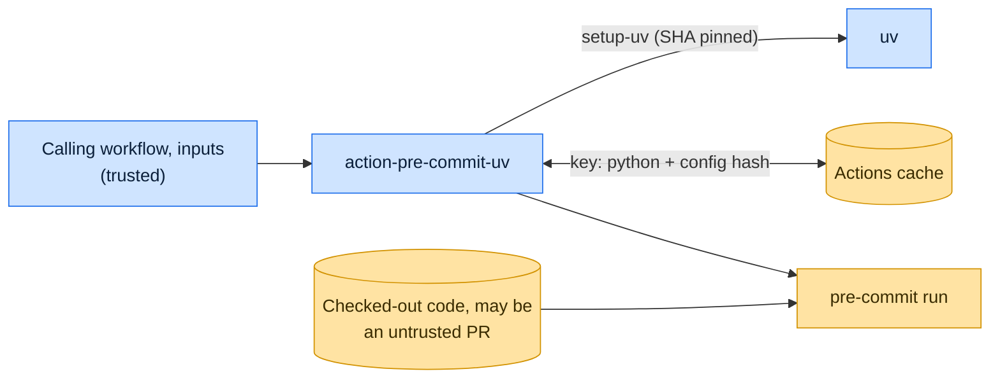

# Threat model

This model says what action-pre-commit-uv trusts, where untrusted input enters, and which guarantees hold at each
boundary, so a report can be classified as a vulnerability or a bug. [SECURITY.md](SECURITY.md) covers reporting; if the
two disagree, SECURITY.md wins and we fix this file.

## How action-pre-commit-uv works

The action installs uv with a SHA-pinned `astral-sh/setup-uv`, at the newest release that `setup-uv` bundles a checksum
for, unless uv is already present (`uv-install`). It restores `~/.cache/pre-commit` keyed by the interpreter and the
hash of `.pre-commit-config.yaml`, and runs `pre-commit run` through `uv run` when the repository has a
`pyproject.toml`, or `uvx` when it does not, with the latest `pre-commit-uv` added. `extra_args` reaches the shell only
through an environment variable, never through `${{ }}` interpolation in a script; `uv-install` is used only in step
conditions.

## Compared with similar tools

We drew the boundary where comparable projects in other ecosystems draw theirs. The shared rule, stated by the
[Node.js threat model](https://github.com/nodejs/node/blob/main/SECURITY.md#the-nodejs-threat-model), is that a report
which first needs a trusted element compromised is out of scope; the first triage question, as
[DOMPurify](https://github.com/cure53/DOMPurify/blob/main/SECURITY.md#what-we-consider-a-vulnerability) puts it, is what
the attacker controls.

| Project                                                                                                                                                | Language | Where it draws the line                                                                                                          |
| ------------------------------------------------------------------------------------------------------------------------------------------------------ | -------- | -------------------------------------------------------------------------------------------------------------------------------- |
| [GitHub Actions hardening guide](https://docs.github.com/en/actions/security-for-github-actions/security-guides/security-hardening-for-github-actions) | Actions  | Inputs must reach scripts through environment variables, not expression interpolation; untrusted code must not run with secrets. |
| [pre-commit/action](https://github.com/pre-commit/action)                                                                                              | Actions  | The upstream action this one mirrors; reports go through Tidelift.                                                               |
| [Lefthook](https://github.com/evilmartians/lefthook/security/policy)                                                                                   | Go       | Runs the commands its configuration names by design; that is not a vulnerability.                                                |

## Trusted

An attacker who controls any of these already has what action-pre-commit-uv could give them:

- The calling workflow, its trigger, permissions and inputs.
- The runner, `setup-uv`, the uv release it installs, and the packages installed from PyPI.
- `.pre-commit-config.yaml` and its hooks, as far as the workflow chose to run them.

## Untrusted inputs

| Input                                   | Comes from                                            | What action-pre-commit-uv guarantees                                                                 |
| --------------------------------------- | ----------------------------------------------------- | ---------------------------------------------------------------------------------------------------- |
| `extra_args`                            | The calling workflow, sometimes built from event data | Passed through an environment variable, so it is split into words but never evaluated as shell code. |
| Cached hook environments and uv's cache | Earlier runs on other refs                            | GitHub scopes caches by branch; the pre-commit cache key includes the config hash.                   |

## Threats and controls

| STRIDE    | Threat                                                         | Control                                                                                                   |
| --------- | -------------------------------------------------------------- | --------------------------------------------------------------------------------------------------------- |
| Tampering | `extra_args` containing \`; curl ...                           | sh\` runs as a command.                                                                                   |
| Tampering | A poisoned cache from a pull request feeds the default branch. | GitHub's cache scoping; the action caches only `~/.cache/pre-commit` and, through `setup-uv`, uv's cache. |

## Release chain

Releases are tags on this repository, created by the release App and published as immutable GitHub Releases. Every
third-party action it uses is pinned to a commit SHA.

## Vulnerability or bug

| Report                                                                | Verdict             | Why                                                    |
| --------------------------------------------------------------------- | ------------------- | ------------------------------------------------------ |
| `extra_args: "--files $(id)"` runs `id`                               | Vulnerability       | Input reached the shell as code.                       |
| A PR's hook steals `GITHUB_TOKEN` in a `pull_request_target` workflow | Not a vulnerability | The workflow chose to run untrusted code with secrets. |
| The cache misses on every run                                         | Bug                 | Performance, no boundary crossed.                      |

## Severity

- **High:** an input runs as shell code, or a cache from an untrusted ref is restored on a trusted one.
- **Medium:** the action runs a tool from a source other than the ones it names.
- **Low:** a step fails or misses the cache without crossing a boundary.

## Accepted risks

- `extra_args` is word-split and glob-expanded by the shell, as documented for pre-commit arguments.
- pre-commit and pre-commit-uv are not version-pinned: each run takes the latest releases. uv is the newest release the
  pinned `setup-uv` knows (`latest-known`), checked against its bundled checksum.

## Keeping this current

Revisit this model when action-pre-commit-uv gains a new input source, network access, a new way to run code, or a new
place it writes to, and whenever an advisory is published.
